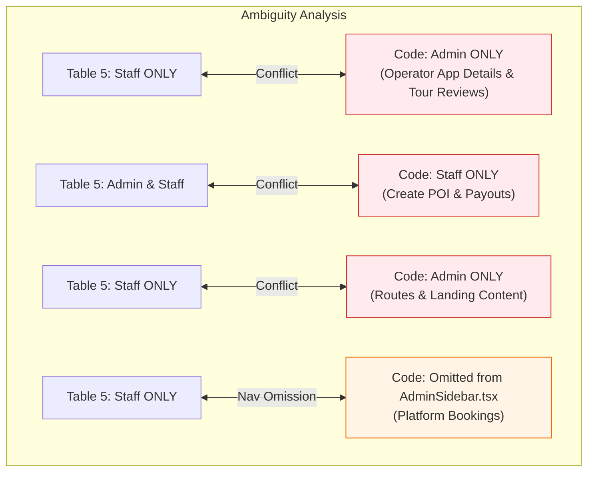

# TRIPMATE — BATCH I ADMIN/STAFF UI/UX COMPLETION AUDIT REPORT (REVISED & CORRECTED)

**Document Version:** 2.0.0 (Corrected Authoritative Baseline)  
**Audit Date:** October 28, 2026  
**Auditor:** Antigravity UI/UX Specialist Pair  
**Repository:** `FPTUCapstone/Capstone_FE`  
**Authoritative Baseline:** `Report3_Software-Requirement-Specification.docx` — **ORIGINAL, NOT V2** (SHA-256 `C7636775D4208D8284905A04AF5F79EACD4D2D05CB72D1022B12E7E830390BE5`)  
**SRS Reference Tables:** Table 2 (Use Cases UC-01 to UC-74), Table 4.1 (Web Screen List #1–#41), Table 5 (Screen Authorization Matrix)  
**Batch Organization Restored:**
- **Batch I1:** Admin Core & User Management (Screens #2–#9, #23, #35, #36)
- **Batch I2:** Catalogue, Route & Tour Moderation (Screens #10–#22, #24–#27)
- **Batch I3:** Finance, Reports, Audit & Content (Screens #28–#34, #37–#41)
**Audit Mode:** Strict Read-Only Audit. No production code modified, committed, pushed, or merged.

---

## 1. Executive Summary & Verification of Quality Baseline

### 1.1 Purpose of Revision
This revised audit corrects earlier errors regarding Use Case mappings, Screen ID numbering, and batch partitioning by strictly aligning with the original `Report3_Software-Requirement-Specification.docx`. All screen identifications are synchronized with **Table 4.1 (Web Screen List, Screens #1 through #41)**, Use Case IDs are verified against **Table 2 (System Use Cases UC-01 through UC-74)**, and authorized roles are cross-referenced with **Table 5 (Screen Authorization Matrix)**.

### 1.2 Quality Baseline Verification
The current repository workspace on branch `feature/batch-h-partner-workspace` was checked against required local quality gates:
- **Node.js & Vitest Test Suites:** `npm test` — **3,052 of 3,052 automated tests passed** (0 failures).
- **TypeScript Typecheck:** `npm run typecheck` (`tsc --noEmit`) — **0 errors**.
- **ESLint Code Quality:** `npm run lint` — **0 errors, 0 warnings**.
- **Turbopack Production Build:** `npm run build` — **Compiled successfully in 7.0s** (All 66 static and dynamic routes generated cleanly).

---

## 2. Batch H Protection & Working Tree Reconciliation Strategy

> [!CAUTION]
> **CRITICAL REPOSITORY DISCREPANCY: Batch H Work Untracked on `develop`**
>
> An inspection of `git log origin/develop`, commit `2eee258` (PR #129 merge), and `git status --porcelain` reveals that the actual Batch H Partner Workspace redesign was never committed to `develop`:
> - PR #129 only committed `BATCH_H_PARTNER_WORKSPACE_REPORT.md` and 1 line in `OperatorProfilePage.tsx`.
> - Over 60 modified files across `app/partner/` and `src/features/operator/` remain as **uncommitted working-tree modifications**.
> - Critical components remain **untracked**:
>   - `src/features/operator/finance/components/payouts/PartnerPayoutClient.tsx` (& `.test.tsx`)
>   - `src/features/operator/finance/components/revenue/PartnerRevenueClient.tsx` (& `.test.tsx`)
>   - `src/features/operator/common/components/` & `src/features/operator/common/index.ts`
>   - `src/features/operator/common/resources/vi.ts`

### Recommended Safe Reconciliation Strategy:
1. **Zero Data Loss Rule:** Do NOT run `git checkout -- .`, `git reset --hard`, `git stash drop`, or clean untracked files.
2. **Dedicated Branching:**
   - Create a dedicated branch for Batch H completion: `git checkout -b fix/batch-h-partner-workspace-assets`.
   - Stage and commit all uncommitted Batch H operator files under Conventional Commit: `feat(operator): commit missing Batch H partner workspace components and tests`.
   - Submit a formal PR to merge this work cleanly into `develop`.
3. **Isolated Batch I Start:** Only after Batch H is securely committed to a branch or merged to `develop`, cut a clean feature branch: `feature/batch-i-admin-uiux-completion` from `develop`.

---

## 3. Authoritative Screen Classification Matrix (Screens #1–#41)

Cross-referenced with original Report 3 Table 4.1, Table 2, Table 5, and actual codebase files.

### Classification Counts across 40 Admin/Staff Screens (#2–#41):
- **`UI_COMPLETE`:** **6 Screens** (Screens #4, #5, #10, #16, #35, #37)
- **`UI_PARTIAL`:** **22 Screens** (Screens #2, #3, #11, #12, #13, #14, #15, #17, #23, #24, #25, #26, #28, #29, #31, #32, #33, #34, #38, #39, #40, #41)
- **`UI_MISSING`:** **12 Screens** (Screens #6, #7, #8, #9, #18, #19, #20, #21, #22, #27, #30, #36)
*(Note: Screen #1 is the Public Landing Page, categorized under Public Website scope).*

### Comprehensive Inventory:

| SRS Screen # | Screen Title (SRS Table 4.1) | Route Path | Implementation File | Restored Batch | Corrected Use Case (SRS Table 2) | Authorized Roles (SRS Table 5) | Codebase Route Guard | Audit Classification |
| :---: | :--- | :--- | :--- | :---: | :--- | :---: | :---: | :---: |
| **#1** | TripMate Landing Page | `/` | `app/page.tsx` | Public | UC-12, UC-24 | Guest | Public | Scope: Public Website |
| **#2** | Administration Login | `/admin/login` | `src/features/admin/auth/AdminLoginPage.tsx` | Batch I1 | **UC-04** (Sign In) | Admin, Staff | Public | `UI_PARTIAL` (Theme: Navy & Blue Button) |
| **#3** | Administration Reset Password | `/admin/forgot-password` | `app/admin/forgot-password/page.tsx` | Batch I1 | **UC-06** (Reset Password) | Admin, Staff | Public | `UI_PARTIAL` (Theme: Navy Shell) |
| **#4** | Administration Change Password | `/admin/account/security` | `src/features/admin/security/components/ChangePasswordForm.tsx` | Batch I1 | **UC-07** (Change Password) | Admin, Staff | Admin, Staff | `UI_COMPLETE` (Batch E) |
| **#5** | Admin Dashboard | `/admin` | `src/features/admin/dashboard/AdminDashboardView.tsx` | Batch I1 | Governance Overview | Admin | Admin Only | `UI_COMPLETE` (Batch E) |
| **#6** | User Accounts List | `/admin/users` | `app/admin/(console)/users/page.tsx` | Batch I1 | **UC-47** (View User Accounts) | Admin, Staff | Admin Only | `UI_MISSING` (Placeholder Stub) |
| **#7** | User Account Details | `/admin/users/[userId]` | `app/admin/(console)/users/[userId]/page.tsx` | Batch I1 | **UC-47** (View User Accounts) | Admin, Staff | Admin Only | `UI_MISSING` (Placeholder Stub) |
| **#8** | Lock Account Confirmation | `/admin/users/[userId]` (Modal) | N/A | Batch I1 | **UC-48** (Lock User Account) | Admin, Staff | N/A | `UI_MISSING` |
| **#9** | Unlock Account Confirmation | `/admin/users/[userId]` (Modal) | N/A | Batch I1 | **UC-49** (Unlock User Account) | Admin, Staff | N/A | `UI_MISSING` |
| **#10** | Pending Operator Applications List | `/admin/tour-operator-applications` | `src/features/admin/tour-operator-applications/OperatorApplicationListView.tsx` | Batch I2 | **UC-50, UC-51** | **Staff Only** | Admin, Staff | `UI_COMPLETE` |
| **#11** | Operator Application Details | `/admin/tour-operator-applications/[userId]` | `src/features/admin/tour-operator-applications/OperatorApplicationDetailView.tsx` | Batch I2 | **UC-50, UC-51** | **Staff Only** | **Admin Only (CONFLICT)** | `UI_PARTIAL` |
| **#12** | Operator Rejection Reason | `/admin/tour-operator-applications/[userId]` (Modal) | `src/features/admin/tour-operator-applications/OperatorApplicationDetailView.tsx` | Batch I2 | **UC-51** (Reject Operator App) | **Staff Only** | **Admin Only (CONFLICT)** | `UI_PARTIAL` |
| **#13** | Pending Tour Posts List | `/admin/tours/reviews` | `src/features/admin/tours/components/TourApprovalQueueScreen.tsx` | Batch I2 | **UC-60, UC-61** | **Staff Only** | **Admin Only (CONFLICT)** | `UI_PARTIAL` |
| **#14** | Tour Content & Pricing Details | `/admin/tours/reviews/[id]` | `src/features/admin/tours/components/TourReviewDetailScreen.tsx` | Batch I2 | **UC-60, UC-61** | **Staff Only** | **Admin Only (CONFLICT)** | `UI_PARTIAL` |
| **#15** | Tour Rejection / Revision Reason | `/admin/tours/reviews/[id]` (Modal) | `src/features/admin/tours/components/TourReviewDecisionModal.tsx` | Batch I2 | **UC-61** (Reject Tour Post) | **Staff Only** | **Admin Only (CONFLICT)** | `UI_PARTIAL` |
| **#16** | POIs & Master Data List | `/admin/catalogue/points-of-interest` | `src/features/admin/catalogue/components/PoiCatalogScreen.tsx` | Batch I2 | **UC-52, UC-53, UC-54** | Admin, Staff | Admin, Staff | `UI_COMPLETE` |
| **#17** | Create POI | `/admin/catalogue/points-of-interest/new` | `src/features/admin/catalogue/components/CreatePoiScreen.tsx` | Batch I2 | **UC-52** (Create POI) | Admin, Staff | **Staff Only (CONFLICT)** | `UI_PARTIAL` |
| **#18** | Update POI | `/admin/catalogue/points-of-interest/[id]/edit` | N/A | Batch I2 | **UC-53** (Update POI) | Admin, Staff | N/A | `UI_MISSING` |
| **#19** | Deactivate / Remove POI Confirmation | `/admin/catalogue/points-of-interest` (Modal) | N/A | Batch I2 | **UC-54** (Remove POI) | Admin Only | N/A | `UI_MISSING` |
| **#20** | Routes List | `/admin/routes` | `app/admin/(console)/routes/page.tsx` | Batch I2 | **UC-55, UC-56** | **Staff Only** | Admin Only (CONFLICT) | `UI_MISSING` (Placeholder Stub) |
| **#21** | Create Route | `/admin/routes/create` | `app/admin/(console)/routes/create/page.tsx` | Batch I2 | **UC-55** (Create Route) | **Staff Only** | Admin Only (CONFLICT) | `UI_MISSING` (Placeholder Stub) |
| **#22** | Update Route | `/admin/routes/[id]/edit` | N/A | Batch I2 | **UC-56** (Update Route) | **Staff Only** | N/A | `UI_MISSING` |
| **#23** | Algorithm Parameters Configuration | `/admin/settings/algorithm-parameters` | `src/features/admin/settings/AlgorithmConfigScreen.tsx` | Batch I1 | **UC-57** (Config Algorithm) | Admin Only | Admin Only | `UI_PARTIAL` (Legacy Tokens) |
| **#24** | Active Trips Monitor | `/admin/trips/active` | `src/features/admin/trips/ActiveTripsScreen.tsx` | Batch I2 | **UC-58** (View Active Trips) | **Staff Only** | Admin, Staff | `UI_PARTIAL` (Legacy Tokens) |
| **#25** | Active Trip Details | `/admin/trips/active/[id]` | `src/features/admin/trips/ActiveTripDetailsScreen.tsx` | Batch I2 | **UC-59** (Active Trip Details) | **Staff Only** | Admin, Staff | `UI_PARTIAL` (Legacy Tokens) |
| **#26** | Platform Bookings List | `/admin/bookings` | `src/features/admin/bookings/PlatformBookingsScreen.tsx` | Batch I2 | **UC-62** (View Platform Bookings)| **Staff Only** | **Staff Only (Omitted Nav)** | `UI_PARTIAL` (Omitted Nav) |
| **#27** | Platform Booking Details | `/admin/bookings` (Drawer/Modal) | N/A | Batch I2 | **UC-62** (View Platform Bookings)| **Staff Only** | N/A | `UI_MISSING` |
| **#28** | Payout Records List | `/admin/payouts` | `src/features/admin/payouts/PayoutRecordsScreen.tsx` | Batch I3 | **UC-63** (View Payout Records) | Admin, Staff | **Staff Only (CONFLICT)** | `UI_PARTIAL` (Legacy Tokens) |
| **#29** | Payout Details (Admin Review) | `/admin/payouts/[payoutId]` | `src/features/admin/payouts/PayoutReviewScreen.tsx` | Batch I3 | **UC-64, UC-65** | Admin Only | **Staff Only (CONFLICT)** | `UI_PARTIAL` (Legacy Tokens) |
| **#30** | Confirm Payout Settlement | `/admin/payouts/settlement` | `app/admin/(console)/payouts/settlement/page.tsx` | Batch I3 | **UC-65** (Confirm Settlement) | Admin Only | Admin Only | `UI_MISSING` (Placeholder Stub) |
| **#31** | Landing Page Content Management | `/admin/landing-content` | `src/features/admin/landing/LandingContentScreen.tsx` | Batch I3 | **UC-66** (Landing Content) | **Staff Only** | Admin Only (CONFLICT) | `UI_PARTIAL` (Legacy Dark Navy) |
| **#32** | Statistical Reports | `/admin/reports` | `src/features/admin/reports/StatisticalReportsView.tsx` | Batch I3 | **UC-67** (Export Stat Reports) | Admin Only | Admin Only | `UI_PARTIAL` (Legacy Dark Navy) |
| **#33** | System Audit Logs List | `/admin/audit-logs` | `src/features/admin/audit-logs/AuditLogManagementView.tsx` | Batch I3 | **UC-68** (View Audit Logs) | Admin Only | Admin Only | `UI_PARTIAL` (Legacy Dark Navy) |
| **#34** | Audit Log Details | `/admin/audit-logs` (Modal) | `src/features/admin/audit-logs/AuditLogDetailsModal.tsx` | Batch I3 | **UC-69** (Audit Log Details) | Admin Only | Admin Only | `UI_PARTIAL` (Legacy Dark Navy) |
| **#35** | Staff Dashboard | `/admin/staff` | `src/features/admin/dashboard/StaffDashboardView.tsx` | Batch I1 | Operations Overview | Staff Only | Staff Only | `UI_COMPLETE` (Batch E) |
| **#36** | Create Staff Account | `/admin/staff-accounts/new` | N/A | Batch I1 | **UC-47** (Staff Creation) | Admin Only | N/A | `UI_MISSING` |
| **#37** | Platform Revenue Report | `/admin` (Revenue Tab) | `src/features/admin/dashboard/AdminDashboardView.tsx` | Batch I3 | Financial Governance | Admin Only | Admin Only | `UI_COMPLETE` (Batch E) |
| **#38** | Export Platform Revenue Report | `/admin` (Modal) | N/A | Batch I3 | Financial Governance | Admin Only | N/A | `UI_PARTIAL` |
| **#39** | Payout Request Review (Staff Verification)| `/admin/payouts/[payoutId]` | `src/features/admin/payouts/PayoutReviewScreen.tsx` | Batch I3 | **UC-64** (Review Payout Request) | **Staff Only** | Staff Only | `UI_PARTIAL` (Legacy Tokens) |
| **#40** | Approve Payout Request Confirmation | `/admin/payouts/[payoutId]` (Modal) | `src/features/admin/payouts/PayoutReviewScreen.tsx` | Batch I3 | **UC-73** (Approve Payout Request)| **Staff Only** | Staff Only | `UI_PARTIAL` |
| **#41** | Reject Payout Request Confirmation | `/admin/payouts/[payoutId]` (Modal) | `src/features/admin/payouts/PayoutReviewScreen.tsx` | Batch I3 | **UC-74** (Reject Payout Request) | **Staff Only** | Staff Only | `UI_PARTIAL` |

---

## 4. Ambiguous Requirements Register (`AMBIGUOUS_REQUIREMENT`)

Per instructions, **all discrepancies between SRS Table 4.1, Table 5, Table 2 (Actor descriptions), and current implementation code are recorded as `AMBIGUOUS_REQUIREMENT`**. No authorization or RBAC rules will be modified without explicit Product Owner authorization.

| Ambiguity Ref | Feature / Screens | SRS Table 5 Rule | SRS Narrative / Other Tables | Current Codebase Implementation | Impact & Ambiguity Summary |
| :---: | :--- | :--- | :--- | :--- | :--- |
| **AMB-01** | Tour Operator Application Review (Screens #11, #12) | **Staff Only** | Table 2 (Actor Description, BR-19): "Only an Administrator may approve or reject a Tour Operator application..." | `app/admin/(console)/tour-operator-applications/[userId]/page.tsx:28` blocks Staff (`session.role === 'Staff'`) and allows Administrator only. | **Conflict:** Table 5 specifies Staff is the sole actor, whereas BR-19 states Administrator, and the code blocks Staff. Staff cannot inspect details. |
| **AMB-02** | Tour Post Approval Review (Screens #13, #14, #15) | **Staff Only** | UC-60 / UC-61: "Allows a Staff member to review a tour package..." | `app/admin/(console)/tours/reviews/page.tsx:29` and `.../[id]/page.tsx:29` block Staff (`session.role === 'Staff'`) and allow Administrator only. | **Conflict:** Staff sidebar lists "Tour Approvals", but clicking it renders an Access Denied view because code permits Admin only, directly contradicting Table 5. |
| **AMB-03** | Master Catalogue POI Creation (Screen #17) | **Admin & Staff** | UC-52: "Allows an Administrator or Staff member to add a new Point of Interest..." | `app/admin/(console)/catalogue/points-of-interest/new/page.tsx:28` blocks Administrator (`session.role !== 'Staff'`). | **Conflict:** Administrator is locked out of creating POIs in code, violating both Table 5 and UC-52 text. |
| **AMB-04** | Route Network Management (Screens #20, #21, #22) | **Staff Only** | UC-55 / UC-56: "Allows a Staff member to create/update a route..." | `app/admin/(console)/routes/page.tsx:28` blocks Staff (`session.role !== 'Administrator'`). | **Conflict:** Staff is designated owner in Table 5, but code restricts the route directory to Administrator. |
| **AMB-05** | Payout Records & Review Scope (Screens #28, #29, #39) | **Screen 28: Admin & Staff** **Screen 39: Staff** **Screen 29: Admin** | UC-63, UC-64, UC-65: Staff verifies and approves for settlement (UC-73); Administrator confirms bank settlement (UC-65). | `app/admin/(console)/payouts/page.tsx:31` blocks Administrator (`session.role !== 'Staff'`). | **Conflict:** Code locks out Administrator completely from `/admin/payouts`, preventing Administrator from reaching Screen #29 / #30 for settlement confirmation. |
| **AMB-06** | Landing Page CMS (Screen #31) | **Staff Only** | UC-66: "Allows a Staff member to modify supported content displayed on the TripMate public landing page..." | `app/admin/(console)/landing-content/page.tsx:28` blocks Staff (`session.role !== 'Administrator'`). | **Conflict:** Code restricts CMS editing to Administrator, whereas Table 5 and UC-66 designate Staff. |
| **AMB-07** | Platform Bookings Navigation (Screen #26) | **Staff Only** | UC-62: "Allows a Staff to inspect booking records across the entire platform..." | Route `/admin/bookings` exists but is completely omitted from `AdminSidebar.tsx` navigation. | **Omission:** Route is unreachable via UI navigation for either role. |

---

## 5. Confirmed vs. Unverified/Proposed Backend API Contracts

To preserve strict backend ownership boundaries, all API dependencies are categorized as either **Confirmed Real Endpoints** (existing proxy routes in `app/api/admin/`) or **Unverified / Proposed Endpoints** (missing contracts requiring mock/presentation fallback).

### 5.1 Confirmed Backend Proxy Routes (`app/api/admin/`)

| Endpoint Path | HTTP Method | Associated SRS Screens | Confirmed Features & Status |
| :--- | :---: | :---: | :--- |
| `/api/admin/session` | POST, DELETE | Screen #2 | Admin/Staff authentication, cookie seal management |
| `/api/admin/account/security/change-password` | POST | Screen #4 | Change password handler with old credential verification |
| `/api/admin/tour-operator-applications/[userId]` | GET | Screen #11 | Operator verification dossier and document URL retrieval |
| `/api/admin/tour-operator-applications/[userId]/approve` | POST | Screen #12 | Operator approval mutation |
| `/api/admin/tour-operator-applications/[userId]/reject` | POST | Screen #12 | Operator rejection with mandatory rejection reason |
| `/api/admin/pois` & `/catalogue` | GET, POST | Screens #16, #17 | Master POI listing, search filters, and new POI creation |
| `/api/admin/trips/active` & `.../[id]` | GET | Screens #24, #25 | Active trips monitoring and live incident/FSM progress |
| `/api/admin/bookings` | GET | Screen #26 | Platform booking transaction list with status filters |
| `/api/admin/payouts` & `.../[payoutId]` | GET | Screens #28, #29, #39 | Operator payout requests, banking info, and transaction list |
| `/api/admin/payouts/[payoutId]/approve` | POST | Screen #40 | Staff payout approval for settlement (UC-73) |
| `/api/admin/payouts/[payoutId]/reject` | POST | Screen #41 | Staff payout rejection with reason (UC-74) |
| `/api/admin/system-configs/algorithm-parameters` | GET, PUT | Screen #23 | Clustering weights, speed coefficients, weather thresholds |
| `/api/admin/landing-content/[[...path]]` | GET, PUT | Screen #31 | Landing page hero banners, featured locations, FAQ items |
| `/api/admin/audit-logs` & `.../[id]` | GET | Screens #33, #34 | Immutable system audit records and detailed JSON diff payloads |

### 5.2 Unverified / Proposed Backend Endpoints (Missing Contracts)

| Missing Endpoint Path | HTTP Method | Target SRS Screen | Required DTO / Payload Specification | Safe Frontend Presentation Strategy |
| :--- | :---: | :---: | :--- | :--- |
| `/api/admin/users` | GET | Screen #6 | Paginated user accounts (`id`, `name`, `email`, `role`, `status`, `tripsCount`) | Present clean Empty/Loading/Error states with mock fixture fallback |
| `/api/admin/users/[userId]` | GET | Screen #7 | Detailed user profile, registration timeline, activity logs | Present mock profile view; display backend notice if unconfigured |
| `/api/admin/users/[userId]/lock` | POST | Screen #8 | `{ reason: string, durationDays?: number }` | Present accessible confirmation modal; simulate mutation feedback safely |
| `/api/admin/users/[userId]/unlock` | POST | Screen #9 | `{ note?: string }` | Present accessible confirmation modal with safety warning |
| `/api/admin/staff-accounts` | POST | Screen #36 | `{ fullName: string, email: string, permissions: string[] }` | Present standard form with client validation; no fake database persistence |
| `/api/admin/pois/[id]` | PUT | Screen #18 | Full POI payload modification | Build edit form matching Screen #17 structure |
| `/api/admin/pois/[id]/status` | PATCH | Screen #19 | `{ active: boolean, reason?: string }` | Present deactivation confirmation modal with affected tours warning |
| `/api/admin/routes` | GET, POST | Screens #20, #21 | Route origin/destination POIs, transport mode, distance, polyline | Present clean directory table and route creation form |
| `/api/admin/routes/[id]` | PUT | Screen #22 | Route segment update payload | Build route edit form matching Screen #21 |
| `/api/admin/bookings/[id]` | GET | Screen #27 | Detailed passenger manifest, payment logs, coupon breakdown | Slide-over drawer presenting booking metadata |
| `/api/admin/payouts/settlement/execute` | POST | Screen #30 | `{ settlementMonth: string, payoutIds: string[] }` | Present batch settlement preview; disallow fake banking completion |
| `/api/admin/reports/export` | GET | Screen #32, #38 | Streamable CSV/PDF file endpoint with date range params | Download progress bar indicator |

---

## 6. Audit Conclusion & Next Steps

1. **Baseline Reconciliation:** The audit now strictly aligns with original Report 3 Tables 2, 4.1, and 5.
2. **Ambiguity Deferral:** All 7 role/guard conflicts are cataloged under Section 4 and must remain untouched until the Product Owner decides the authoritative resolution.
3. **Execution Plan:** Refer to [`BATCH_I_ADMIN_STAFF_UIUX_IMPLEMENTATION_PLAN.md`](./BATCH_I_ADMIN_STAFF_UIUX_IMPLEMENTATION_PLAN.md) for the sequential, UI-only execution roadmap.
