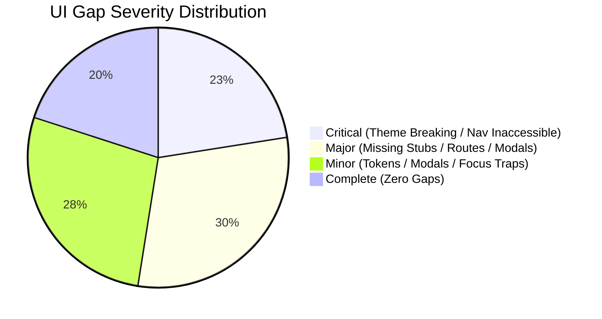

# TRIPMATE — BATCH I ADMIN/STAFF UI/UX IMPLEMENTATION PLAN

**Document Version:** 1.0.0  
**Date:** October 28, 2026  
**Author:** Antigravity UI/UX Specialist Pair  
**Repository:** `FPTUCapstone/Capstone_FE`  
**Authoritative Baseline:** `Report3_Software-Requirement-Specification.docx` — **ORIGINAL, NOT V2** (SHA-256 `C7636775D4208D8284905A04AF5F79EACD4D2D05CB72D1022B12E7E830390BE5`)  
**Design System Foundation:** Forest & Warm Ivory tokens established in Batch E0/E (`docs/ux/admin/BATCH_E0_MASTER_UIUX_PLAN.md`)  
**Scope Restriction:** Strict UI-Only Implementation. Zero backend contract modifications, zero fake successful financial or moderation actions, zero unauthorized RBAC changes.

---

## 1. Executive Summary & Implementation Principles

### 1.1 Objective
This plan defines the sequential, minimal UI/UX refinement roadmap for all Administrator and Staff screens across Batch I. It rectifies visual inconsistencies, replaces placeholder stubs with accessible, high-fidelity presentation views, completes missing modals and drawers, ensures responsive mobile-to-desktop layouts, and adheres strictly to the approved **Forest & Warm Ivory** design system.

### 1.2 Core Architectural & Delivery Principles
1. **Zero Data Loss & Batch H Protection:** Existing uncommitted Batch H work must be preserved and safely reconciled before creating the Batch I feature branch.
2. **Preserve Backend Boundaries:** Backend owns business logic, database mutations, and authoritative RBAC. The frontend will safely display loading, empty, and presentation states with mock data fallbacks when backend APIs are unverified.
3. **No Fabricated Business Outcomes:** The UI will never fabricate successful bank disbursements, actual user account bans, or production payouts. Missing backend capabilities will present clearly marked "Simulated / Presentation Mode" or disable action CTAs with descriptive tooltips.
4. **Strict Scope Partitioning:** Work proceeds in three disciplined sub-batches:
   - **Batch I1:** Admin Core & User Management
   - **Batch I2:** Catalogue, Route & Tour Moderation
   - **Batch I3:** Finance, Reports, Audit & Content

---

## 2. Corrected Screen–UC–Role Mapping & Baseline Inventory

| SRS Screen # | Screen Title (SRS Table 4.1) | Route Path | Implementation File | Restored Batch | Corrected Use Case | Authorized Roles (SRS Table 5) | UI Status | Gap Severity |
| :---: | :--- | :--- | :--- | :---: | :--- | :---: | :---: | :---: |
| **#2** | Administration Login | `/admin/login` | `src/features/admin/auth/AdminLoginPage.tsx` | Batch I1 | **UC-04** | Admin, Staff | `UI_PARTIAL` | **Major** (Dark Navy `#0F1B2D` & Blue Button `#1D4ED8`) |
| **#3** | Administration Reset Password | `/admin/forgot-password` | `app/admin/forgot-password/page.tsx` | Batch I1 | **UC-06** | Admin, Staff | `UI_PARTIAL` | **Major** (Dark Navy Shell) |
| **#4** | Administration Change Password | `/admin/account/security` | `src/features/admin/security/components/ChangePasswordForm.tsx` | Batch I1 | **UC-07** | Admin, Staff | `UI_COMPLETE` | None (Merged Batch E) |
| **#5** | Admin Dashboard | `/admin` | `src/features/admin/dashboard/AdminDashboardView.tsx` | Batch I1 | Governance | Admin | `UI_COMPLETE` | None (Merged Batch E) |
| **#6** | User Accounts List | `/admin/users` | `app/admin/(console)/users/page.tsx` | Batch I1 | **UC-47** | Admin, Staff | `UI_MISSING` | **Major** (Stub View) |
| **#7** | User Account Details | `/admin/users/[userId]` | `app/admin/(console)/users/[userId]/page.tsx` | Batch I1 | **UC-47** | Admin, Staff | `UI_MISSING` | **Major** (Stub View) |
| **#8** | Lock Account Confirmation | `/admin/users/[userId]` (Modal) | N/A | Batch I1 | **UC-48** | Admin, Staff | `UI_MISSING` | **Major** (Missing Dialog) |
| **#9** | Unlock Account Confirmation | `/admin/users/[userId]` (Modal) | N/A | Batch I1 | **UC-49** | Admin, Staff | `UI_MISSING` | **Major** (Missing Dialog) |
| **#10** | Pending Operator Applications List | `/admin/tour-operator-applications` | `src/features/admin/tour-operator-applications/OperatorApplicationListView.tsx` | Batch I2 | **UC-50, UC-51** | Staff | `UI_COMPLETE` | None (Batch E Verified) |
| **#11** | Operator Application Details | `/admin/tour-operator-applications/[userId]` | `src/features/admin/tour-operator-applications/OperatorApplicationDetailView.tsx` | Batch I2 | **UC-50, UC-51** | Staff | `UI_PARTIAL` | **Critical** (AMB-01 Conflict) |
| **#12** | Operator Rejection Reason | `/admin/tour-operator-applications/[userId]` (Modal) | `src/features/admin/tour-operator-applications/OperatorApplicationDetailView.tsx` | Batch I2 | **UC-51** | Staff | `UI_PARTIAL` | Minor (History display) |
| **#13** | Pending Tour Posts List | `/admin/tours/reviews` | `src/features/admin/tours/components/TourApprovalQueueScreen.tsx` | Batch I2 | **UC-60, UC-61** | Staff | `UI_PARTIAL` | **Critical** (AMB-02 Conflict) |
| **#14** | Tour Content & Pricing Details | `/admin/tours/reviews/[id]` | `src/features/admin/tours/components/TourReviewDetailScreen.tsx` | Batch I2 | **UC-60, UC-61** | Staff | `UI_PARTIAL` | Minor (Slate card styling) |
| **#15** | Tour Rejection / Revision Reason | `/admin/tours/reviews/[id]` (Modal) | `src/features/admin/tours/components/TourReviewDecisionModal.tsx` | Batch I2 | **UC-61** | Staff | `UI_PARTIAL` | Minor (Focus trap) |
| **#16** | POIs & Master Data List | `/admin/catalogue/points-of-interest` | `src/features/admin/catalogue/components/PoiCatalogScreen.tsx` | Batch I2 | **UC-52, UC-53, UC-54** | Admin, Staff | `UI_COMPLETE` | None (Batch E Verified) |
| **#17** | Create POI | `/admin/catalogue/points-of-interest/new` | `src/features/admin/catalogue/components/CreatePoiScreen.tsx` | Batch I2 | **UC-52** | Admin, Staff | `UI_PARTIAL` | **Critical** (AMB-03 Conflict) |
| **#18** | Update POI | `/admin/catalogue/points-of-interest/[id]/edit` | N/A | Batch I2 | **UC-53** | Admin, Staff | `UI_MISSING` | **Major** (Missing Route) |
| **#19** | Deactivate / Remove POI Confirmation | `/admin/catalogue/points-of-interest` (Modal) | N/A | Batch I2 | **UC-54** | Admin | `UI_MISSING` | **Major** (Missing Dialog) |
| **#20** | Routes List | `/admin/routes` | `app/admin/(console)/routes/page.tsx` | Batch I2 | **UC-55, UC-56** | Staff | `UI_MISSING` | **Major** (Stub View) |
| **#21** | Create Route | `/admin/routes/create` | `app/admin/(console)/routes/create/page.tsx` | Batch I2 | **UC-55** | Staff | `UI_MISSING` | **Major** (Stub View) |
| **#22** | Update Route | `/admin/routes/[id]/edit` | N/A | Batch I2 | **UC-56** | Staff | `UI_MISSING` | **Major** (Missing Route) |
| **#23** | Algorithm Parameters Configuration | `/admin/settings/algorithm-parameters` | `src/features/admin/settings/AlgorithmConfigScreen.tsx` | Batch I1 | **UC-57** | Admin | `UI_PARTIAL` | Minor (Generic Blue theme) |
| **#24** | Active Trips Monitor | `/admin/trips/active` | `src/features/admin/trips/ActiveTripsScreen.tsx` | Batch I2 | **UC-58** | Staff | `UI_PARTIAL` | **Critical** (Legacy Navy theme) |
| **#25** | Active Trip Details | `/admin/trips/active/[id]` | `src/features/admin/trips/ActiveTripDetailsScreen.tsx` | Batch I2 | **UC-59** | Staff | `UI_PARTIAL` | **Critical** (Legacy Navy theme) |
| **#26** | Platform Bookings List | `/admin/bookings` | `src/features/admin/bookings/PlatformBookingsScreen.tsx` | Batch I2 | **UC-62** | Staff | `UI_PARTIAL` | **Critical** (Omitted from Nav & Navy) |
| **#27** | Platform Booking Details | `/admin/bookings` (Drawer/Modal) | N/A | Batch I2 | **UC-62** | Staff | `UI_MISSING` | **Major** (Missing Drawer) |
| **#28** | Payout Records List | `/admin/payouts` | `src/features/admin/payouts/PayoutRecordsScreen.tsx` | Batch I3 | **UC-63** | Admin, Staff | `UI_PARTIAL` | **Critical** (AMB-05 Conflict & Navy) |
| **#29** | Payout Details (Admin Review) | `/admin/payouts/[payoutId]` | `src/features/admin/payouts/PayoutReviewScreen.tsx` | Batch I3 | **UC-64, UC-65** | Admin | `UI_PARTIAL` | **Critical** (AMB-05 Conflict & Navy) |
| **#30** | Confirm Payout Settlement | `/admin/payouts/settlement` | `app/admin/(console)/payouts/settlement/page.tsx` | Batch I3 | **UC-65** | Admin | `UI_MISSING` | **Major** (Stub View) |
| **#31** | Landing Page Content Management | `/admin/landing-content` | `src/features/admin/landing/LandingContentScreen.tsx` | Batch I3 | **UC-66** | Staff | `UI_PARTIAL` | **Critical** (Legacy Dark Navy theme) |
| **#32** | Statistical Reports | `/admin/reports` | `src/features/admin/reports/StatisticalReportsView.tsx` | Batch I3 | **UC-67** | Admin | `UI_PARTIAL` | **Critical** (Legacy Dark Navy theme) |
| **#33** | System Audit Logs List | `/admin/audit-logs` | `src/features/admin/audit-logs/AuditLogManagementView.tsx` | Batch I3 | **UC-68** | Admin | `UI_PARTIAL` | **Critical** (Legacy Navy theme) |
| **#34** | Audit Log Details | `/admin/audit-logs` (Modal) | `src/features/admin/audit-logs/AuditLogDetailsModal.tsx` | Batch I3 | **UC-69** | Admin | `UI_PARTIAL` | Minor (Modal theme) |
| **#35** | Staff Dashboard | `/admin/staff` | `src/features/admin/dashboard/StaffDashboardView.tsx` | Batch I1 | Operations | Staff | `UI_COMPLETE` | None (Merged Batch E) |
| **#36** | Create Staff Account | `/admin/staff-accounts/new` | N/A | Batch I1 | **UC-47** | Admin | `UI_MISSING` | **Major** (Missing Form) |
| **#37** | Platform Revenue Report | `/admin` (Revenue Tab) | `src/features/admin/dashboard/AdminDashboardView.tsx` | Batch I3 | Governance | Admin | `UI_COMPLETE` | None (Merged Batch E) |
| **#38** | Export Platform Revenue Report | `/admin` (Modal) | N/A | Batch I3 | Governance | Admin | `UI_PARTIAL` | Minor (Export Modal) |
| **#39** | Payout Request Review (Staff Verification)| `/admin/payouts/[payoutId]` | `src/features/admin/payouts/PayoutReviewScreen.tsx` | Batch I3 | **UC-64** | Staff | `UI_PARTIAL` | **Critical** (Navy Theme) |
| **#40** | Approve Payout Request Confirmation | `/admin/payouts/[payoutId]` (Modal) | `src/features/admin/payouts/PayoutReviewScreen.tsx` | Batch I3 | **UC-73** | Staff | `UI_PARTIAL` | Minor (Modal Polish) |
| **#41** | Reject Payout Request Confirmation | `/admin/payouts/[payoutId]` (Modal) | `src/features/admin/payouts/PayoutReviewScreen.tsx` | Batch I3 | **UC-74** | Staff | `UI_PARTIAL` | Minor (Modal Polish) |

---

## 3. UI Gaps by Severity Classification



### 3.1 Critical Gaps (Priority 1)
- **Theme Inversion on 6 Screens:** Screens #24, #25 (Active Trips), #26 (Bookings), #28, #29 (Payouts), #31 (Landing CMS), #32 (BI Reports), and #33 (Audit Logs) contain prototype Dark Navy (`#00152a`, `#102a43`) and Neon Cyan (`#71f8e4`, `#006b5f`), contrasting harshly with the Warm Ivory (`#F7F6F2`) console.
- **Omission from Navigation:** Screen #26 (`/admin/bookings`) is completely missing from `AdminSidebar.tsx`.
- **Role Guard Clashes (Pending Product Owner Decision):** Screens #11, #13, #17, #28 have conflicting guards documented in the Ambiguity Register.

### 3.2 Major Gaps (Priority 2)
- **Placeholder Stubs:**
  - Screens #6, #7 (`UserAccountDirectoryUnavailableView.tsx`, `UserAccountDetailUnavailableView.tsx`)
  - Screens #20, #21 (`RouteDirectoryUnavailableView.tsx`, `CreateRouteUnavailableView.tsx`)
  - Screen #30 (`PayoutSettlementUnavailableView.tsx`)
- **Missing Routes & Forms:**
  - Screen #18: Update POI (`/admin/catalogue/points-of-interest/[id]/edit`)
  - Screen #22: Update Route (`/admin/routes/[id]/edit`)
  - Screen #36: Create Staff Account (`/admin/staff-accounts/new` or Modal)
- **Missing Dialogs & Drawers:**
  - Screens #8, #9: Lock & Unlock Confirmation Dialogs
  - Screen #19: Deactivate POI Confirmation Modal
  - Screen #27: Platform Booking Details Drawer

### 3.3 Minor Gaps (Priority 3)
- Retheming `AlgorithmConfigScreen.tsx` (Screen #23) from generic Tailwind blue to Deep Forest Green (`#245747`).
- Adding focus traps and keyboard ESC listeners to decision modals (`TourReviewDecisionModal`, `AuditLogDetailsModal`).
- Adding responsive card list fallback on mobile (375px) for tabular data.

---

## 4. Sub-Batch Implementation Sequence

```mermaid
flowchart LR
    subgraph Batch I1: Core & Users
        I1_1["Replace User Stubs (#6, #7)<br>with Presentation Views"]
        I1_2["Implement Lock/Unlock Dialogs<br>(#8, #9)"]
        I1_3["Add Create Staff Form<br>(#36)"]
        I1_4["Retheme Algorithm Config<br>(#23)"]
    end
    subgraph Batch I2: Catalogue & Moderation
        I2_1["Add Bookings to Nav & Drawer<br>(#26, #27)"]
        I2_2["Retheme Active Trips<br>(#24, #25)"]
        I2_3["Replace Route Stubs (#20, #21)<br>& Add Edit Route (#22)"]
        I2_4["Add Edit POI & Deactivate Modal<br>(#18, #19)"]
        I2_5["Polish Tour Reviews (#13, #14)"]
    end
    subgraph Batch I3: Finance & Content
        I3_1["Retheme Payouts (#28, #29, #39)<br>to Forest & Ivory"]
        I3_2["Replace Settlement Stub (#30)<br>with Batch Preview UI"]
        I3_3["Retheme Landing CMS (#31)<br>to Warm Ivory"]
        I3_4["Retheme BI Reports (#32)<br>& Audit Logs (#33, #34)"]
    end
    Batch I1 --> Batch I2 --> Batch I3
```

### 4.1 Phase 1: Batch I1 — Admin Core & User Management

#### Scope:
0. **Admin Login & Password Reset Retheming (Screens #2, #3):**
   - Retheme `AuthShell.tsx` (when `admin={true}`) from Dark Navy (`#0F1B2D`) to Warm Ivory canvas (`#F7F6F2`) with Forest Charcoal header (`#1C2923`).
   - Retheme submit button in `AdminSignInForm.tsx` to **Deep Forest Green (`#245747`)** with hover (`#1B4337`), eliminating the generic Blue `#1D4ED8`.
   - Update "Forgot Password" link from `#006b5f` to Forest Green (`#245747`).
   - Align `/admin/forgot-password` with the same Forest & Warm Ivory tokens.
1. **User Accounts Management (Screens #6, #7):**
   - Replace `UserAccountDirectoryUnavailableView.tsx` with a high-fidelity `UserAccountDirectoryView.tsx` featuring search by name/email, role filtering pills (Traveler, Tour Operator, Staff), status filtering (Active, Locked, Pending), and responsive card stacking on mobile.
   - Replace `UserAccountDetailUnavailableView.tsx` with `UserAccountDetailView.tsx` presenting user profile summary, registration timestamp, last active session, associated trips count, and role badge.
2. **Lock & Unlock Dialogs (Screens #8, #9):**
   - Implement `LockAccountModal.tsx` (`role="dialog"`, `aria-modal="true"`) requiring reason textarea, suspension duration selector, and Forest Red danger button (`#D32F2F`).
   - Implement `UnlockAccountModal.tsx` presenting safety confirmation note and Forest Green confirm button (`#245747`).
3. **Staff Account Creation (Screen #36):**
   - Implement `CreateStaffAccountModal.tsx` or `/admin/staff/new` form with client validation for name, email, department, and role permissions.
4. **Algorithm Parameters Configuration (Screen #23):**
   - Migrate `AlgorithmConfigScreen.tsx` and `AlgorithmConfigForm.tsx` from generic blue (`bg-blue-600`) to Deep Forest Green (`#245747`) sliders with live numeric badges, card borders (`#E6E4DD`), and safety confirmation on "Reset to Defaults".

#### Target Files:
- `src/components/layout/AuthShell.tsx` (Admin theme branch)
- `src/features/admin/auth/AdminSignInForm.tsx`
- `app/admin/forgot-password/page.tsx`
- `app/admin/(console)/users/page.tsx`
- `app/admin/(console)/users/[userId]/page.tsx`
- `src/features/admin/users/components/UserAccountDirectoryView.tsx` (New)
- `src/features/admin/users/components/UserAccountDetailView.tsx` (New)
- `src/features/admin/users/components/LockAccountModal.tsx` (New)
- `src/features/admin/users/components/UnlockAccountModal.tsx` (New)
- `src/features/admin/users/components/CreateStaffAccountModal.tsx` (New)
- `src/features/admin/settings/AlgorithmConfigScreen.tsx`
- `src/features/admin/settings/AlgorithmConfigForm.tsx`

---

### 4.2 Phase 2: Batch I2 — Catalogue, Route & Tour Moderation

#### Scope:
1. **Platform Bookings (Screens #26, #27):**
   - Add "Platform Bookings" (`/admin/bookings`) item into `AdminSidebar.tsx` navigation under "Operations".
   - Migrate `PlatformBookingsScreen.tsx` table headers from `#00152a` to Forest Charcoal (`#1C2923`) and zebra striping with `#F7F6F2`.
   - Build `PlatformBookingDetailDrawer.tsx` (Screen #27) right-hand slide-over drawer displaying customer contact, tour details, passenger manifest, payment status, and coupon applied.
2. **Active Trips Monitoring (Screens #24, #25):**
   - Migrate `ActiveTripsScreen.tsx` and `ActiveTripDetailsScreen.tsx` from dark navy/teal to Forest Charcoal and Warm Ivory.
   - Refactor simulated GPS map widget to render a clean responsive placeholder with waypoint chips, status pills, and traveler breadcrumb trail.
3. **Route Network Catalogue (Screens #20, #21, #22):**
   - Replace `RouteDirectoryUnavailableView.tsx` with `RouteDirectoryView.tsx` showing origin/destination POIs, distance (km), estimated duration, transport mode badge, and status.
   - Replace `CreateRouteUnavailableView.tsx` with `CreateRouteView.tsx` supporting origin/destination POI selector dropdowns, waypoints array, and distance calculator preview.
   - Create route `app/admin/(console)/routes/[id]/edit/page.tsx` and `UpdateRouteView.tsx` (Screen #22).
4. **POI Updates & Deactivation (Screens #18, #19):**
   - Create route `app/admin/(console)/catalogue/points-of-interest/[id]/edit/page.tsx` and `EditPoiScreen.tsx` reusing form components from `CreatePoiScreen.tsx`.
   - Implement `DeactivatePoiModal.tsx` (Screen #19) warning user about affected tour packages before confirming deactivation.
5. **Tour Posts Moderation Polish (Screens #13, #14, #15):**
   - Refactor `TourReviewDetailScreen.tsx` card styling from `bg-slate-50` to Warm Ivory and White cards with `#E6E4DD` borders.
   - Ensure itinerary accordions retain expanded state during tab transitions.

#### Target Files:
- `src/features/admin/shared/components/AdminSidebar.tsx`
- `src/features/admin/bookings/PlatformBookingsScreen.tsx`
- `src/features/admin/bookings/PlatformBookingDetailDrawer.tsx` (New)
- `src/features/admin/trips/ActiveTripsScreen.tsx`
- `src/features/admin/trips/ActiveTripDetailsScreen.tsx`
- `app/admin/(console)/routes/page.tsx`
- `app/admin/(console)/routes/create/page.tsx`
- `app/admin/(console)/routes/[id]/edit/page.tsx` (New route)
- `src/features/admin/routes/components/RouteDirectoryView.tsx` (New)
- `src/features/admin/routes/components/CreateRouteView.tsx` (New)
- `src/features/admin/routes/components/UpdateRouteView.tsx` (New)
- `app/admin/(console)/catalogue/points-of-interest/[id]/edit/page.tsx` (New route)
- `src/features/admin/catalogue/components/EditPoiScreen.tsx` (New)
- `src/features/admin/catalogue/components/DeactivatePoiModal.tsx` (New)
- `src/features/admin/tours/components/TourReviewDetailScreen.tsx`

---

### 4.3 Phase 3: Batch I3 — Finance, Reports, Audit & Content

#### Scope:
1. **Payout Records & Review Retheming (Screens #28, #29, #39, #40, #41):**
   - Replace `#00152a` and `#006b5f` in `PayoutRecordsScreen.tsx` and `PayoutReviewScreen.tsx` with Forest Charcoal (`#1C2923`) and Deep Forest Green (`#245747`).
   - Add responsive card views for mobile screens (375px).
   - Polish approval and rejection modals (`TourReviewDecisionModal`-style accessible dialogs).
2. **Payout Settlement Execution UI (Screen #30):**
   - Replace `PayoutSettlementUnavailableView.tsx` with `PayoutSettlementView.tsx` rendering monthly settlement summary cards, eligible operator breakdown, net settlement total, and simulated settlement batch preview.
   - Disallow fake bank disbursement completion; present an informational notice: *"Settlement batch generated. Final banking disbursement requires Payment Gateway integration."*
3. **Landing Page CMS Retheming (Screen #31):**
   - Completely retheme `LandingContentScreen.tsx` from `#0a192f` / `#00152a` to the Warm Ivory console canvas (`#F7F6F2`), white card blocks, and Forest Green save buttons.
   - Add live preview panel toggling between Edit Mode and Desktop Landing Page Preview.
4. **Statistical Reports & Business Intelligence (Screen #32):**
   - Migrate `StatisticalReportsView.tsx` charts and metric cards to Forest Charcoal, Sage Green, and Ivory backgrounds.
   - Add clean mock export triggers with accessible progress indicator toasts.
5. **Security Audit Logs (Screens #33, #34):**
   - Migrate `AuditLogManagementView.tsx` and `AuditLogTable.tsx` from `#102a43` navy to standard Forest & Warm Ivory tables.
   - Ensure `AuditLogDetailsModal.tsx` traps keyboard focus and formats JSON diffs in readable syntax-highlighted containers.

#### Target Files:
- `src/features/admin/payouts/PayoutRecordsScreen.tsx`
- `src/features/admin/payouts/PayoutReviewScreen.tsx`
- `app/admin/(console)/payouts/settlement/page.tsx`
- `src/features/admin/payouts/PayoutSettlementView.tsx` (New)
- `src/features/admin/landing/LandingContentScreen.tsx`
- `src/features/admin/reports/StatisticalReportsView.tsx`
- `src/features/admin/audit-logs/AuditLogManagementView.tsx`
- `src/features/admin/audit-logs/AuditLogTable.tsx`
- `src/features/admin/audit-logs/AuditLogDetailsModal.tsx`

---

## 5. Viewport Acceptance Criteria (Responsive Quality Gates)

| Viewport | Target Resolution | Specific Layout & Interactive Acceptance Criteria |
| :--- | :---: | :--- |
| **Desktop** | **1440 × 900** | Full sidebar visible (260px); multi-column metric grids render 4 cards per row; data tables display all columns with sortable headers; slide-over drawers occupy 480px width without horizontal page scroll. |
| **Laptop** | **1024 × 768** | Sidebar collapses to icon-rail or remains fixed; 3-column metric cards; tables maintain legible cell padding; no horizontal page scroll. |
| **Tablet** | **768 × 1024** | Sidebar converts to slide-over mobile drawer triggered by topbar hamburger; metric cards reflow to 2 columns; table records provide horizontal touch-scroll with sticky first column or collapse to card blocks. |
| **Mobile** | **375 × 812** | Console topbar hamburger menu with drawer overlay; metric cards stack in 1 column; data tables transform into accessible card list format; action modals take 92vw width with stacked buttons. |

---

## 6. Verification & Automated Test Strategy

Every task in the sequence will be verified locally against the repository's strict gates:

1. **Unit & Component Testing (`npm test`):**
   - Add behavioral tests for new presentation views (`UserAccountDirectoryView.test.tsx`, `RouteDirectoryView.test.tsx`, `PayoutSettlementView.test.tsx`).
   - Verify modal keyboard behavior: Esc key closes modal, Tab key cycles within modal dialog.
   - Verify all 3,052+ existing tests continue passing with zero regressions.
2. **Type Checking (`npm run typecheck`):**
   - Zero TypeScript compilation errors (`tsc --noEmit`).
3. **ESLint Code Quality (`npm run lint`):**
   - Zero errors, zero warnings across all changed files.
4. **Production Build (`npm run build`):**
   - Turbopack Next.js production build must compile and optimize all 66+ routes cleanly.
5. **Visual Regression Snapshots:**
   - Run screenshot capture scripts (`scripts/capture-final-screenshots.mjs`) to verify zero horizontal overflow on 375px, 768px, 1024px, and 1440px viewports.

---

## 7. Explicit Items Requiring UI Owner or Product Owner Approval

The following items are deferred pending explicit authorization:

1. **Resolution of Ambiguities AMB-01 through AMB-06:** Whether Staff, Administrator, or both are granted access to Operator Application Details, Tour Approvals, POI Creation, Routes, and Payout Records.
2. **User Account Moderation Execution:** Confirmation of whether backend integration is planned before graduation or if Presentation/Mock Mode is accepted for final evaluation.
3. **Route Polyline Rendering Engine:** Approval to use static SVG route geometry versus dynamic Mapbox/Google Maps canvas for the Route Network Catalogue.

*End of Implementation Plan.*
